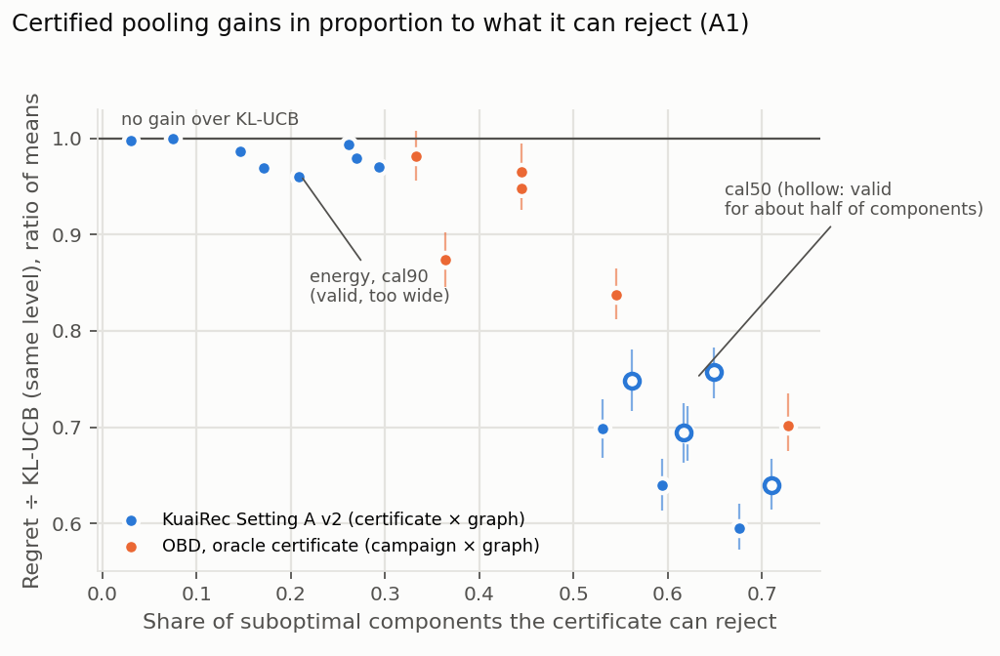
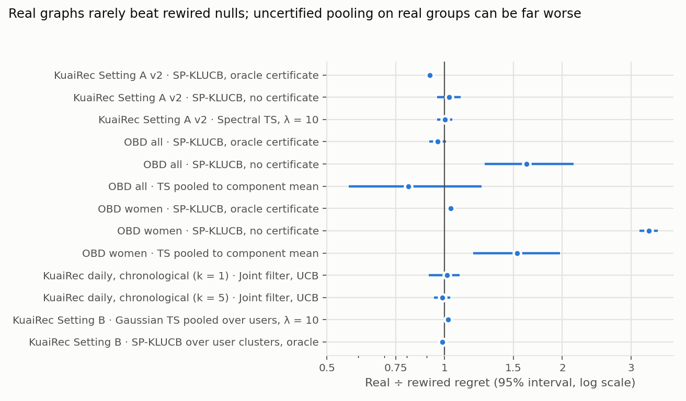
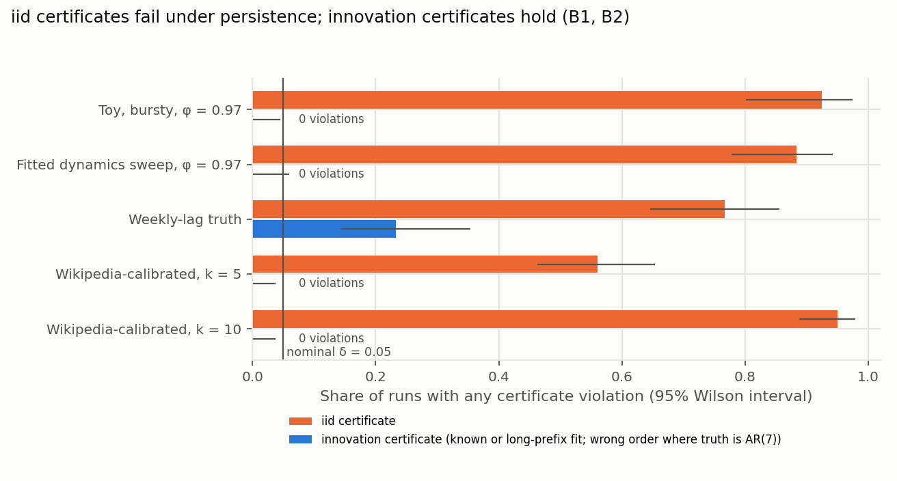
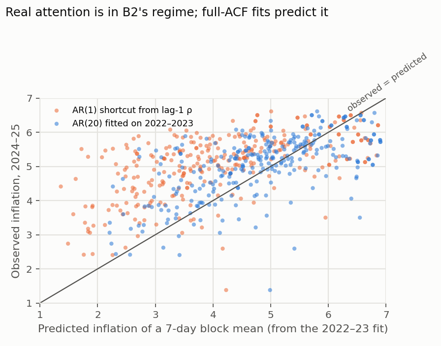
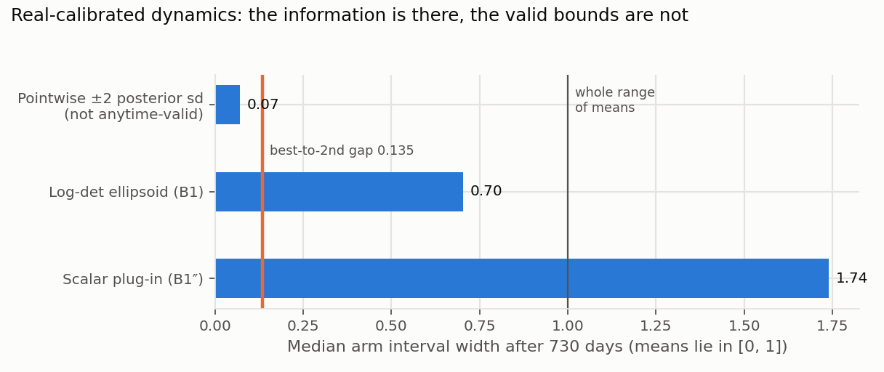

# Experiment Report: Does the Data Back the Theory?

11 October 2026. This report covers every experiment in the repository up to the Setting A v2 expansion that finished overnight. Each theory result in the [theory map](../../research/correlated_arms/README.md) is matched to the experiments that test it, with a verdict.

- **Audience:** authors of the WWW 2027 long paper on correlated arms.
- **Numbers:** cross-experiment figures come from [code/build_report.py](code/build_report.py), which reads the raw run files. Everything else is quoted from the linked experiment reports.

## Contents

1. [Verdicts at a glance](#1-verdicts-at-a-glance)
2. [The evidence base](#2-the-evidence-base)
3. [Mean channel: certified pooling (A1, A4, N1)](#3-mean-channel-certified-pooling-a1-a4-n1)
4. [The bridge: certificates under persistence (B1, B2)](#4-the-bridge-certificates-under-persistence-b1-b2)
5. [Long-run constants and slates (B3, S3, S6)](#5-long-run-constants-and-slates-b3-s3-s6)
6. [Fluctuation channel: dynamic policies (S5, P1)](#6-fluctuation-channel-dynamic-policies-s5-p1)
7. [Which graphs carry correlation (Q1)](#7-which-graphs-carry-correlation-q1)
8. [Algorithm scorecard](#8-algorithm-scorecard)
9. [Threats to validity](#9-threats-to-validity)
10. [What this means for the paper](#10-what-this-means-for-the-paper)
11. [Reproduce](#11-reproduce)

## 1. Verdicts at a glance

| Theory result | Prediction | Verdict | Strongest evidence |
| --- | --- | --- | --- |
| **A1** (SP-UCB regret) | Certified pooling gains only through components whose width is below their gap | **Supported** | Across 16 certificate × graph cells on KuaiRec, the regret ratio falls as the rejectable share rises (Spearman −0.87). The same holds on 6 OBD cells (−0.81). Per instance the link is weak (−0.09) |
| **A4** (cost of loose certificates) | Energy certificates help little when energy-to-gap is about 5 | **Supported** | Energy certificates reject 17–29% of suboptimal components and gain 1–4% against KL-UCB |
| **N1** (misaligned smoother) | Uncertified pooling or smoothing can give near-linear regret | **Supported** | Heavy tails on KuaiRec (Spectral TS on I-coeng: 27% of users above 2× TS). On OBD, an uncertified rule never finds the best item. Setting B: 1.39× per-user TS |
| A2, A3 (path against clique; graph error) | Geometry beyond diameters; perturbation radius | **Untested on data** | Simulation only, in [alignment_paper](../../research/alignment_paper/README.md) |
| **B1 validity** (S1, S2) | Innovation certificates cover with probability ≥ 1 − δ under persistence and correlated shocks | **Supported** | 0 violations in 2,080 toy runs. 0–1% on Wikipedia-calibrated worlds. Known-model rates of 0–3% elsewhere match δ = 0.05 |
| B1 with estimated dynamics | Not covered by the theorem | **Holds with caveats** | A 365-round prefix gives 0%. A 100-round prefix gives 13% at φ = 0.97. A wrong lag order gives 23–40% |
| **B1 regret / power** | Regret bound with information growth ι; persistence costs up to (1 − φ)⁻² | **Valid but vacuous at Web persistence** | Valid elimination eliminates nothing in 20,000 rounds at φ ≥ 0.9. On Wikipedia-calibrated worlds the B1″ interval is 1.74 wide after 2 years, against a pointwise ±2 sd width of 0.07 |
| **B2** (iid certificates fail) | Miscoverage under bursty persistent exposure, from variance inflation (1 + φ)/(1 − φ) | **Strongly supported** | Toy: 85–93% of runs violated. Real-calibrated: 56–95%. Real Wikipedia blocks: 3.6–5.3× inflation over 7 days |
| B2 consequence | iid elimination drops the optimal arm, causing linear regret | **Supported, conditionally** | 28–89% best-arm drops under bursty exposure, then 0.14–0.26 regret per round. At T = 20,000 the invalid rule still has lower total regret. With a large gap (0.135 on Wikipedia) there are no drops |
| **B3.1** (long-run substitution, S3) | Mean information follows the long-run covariance, not lag-1 | **Supported** | Full-ACF fits predict real block inflation within 4–23% (median); the AR(1) shortcut is off by 1.2–3.3× |
| **B3.2** (slate contrast gain) | Contrast variance shrinks by (1 − ρ) | **Exact under its conditions; smaller otherwise** | Exact for equal pairs; 0.28–0.38 instead of 0.10 at ρ = 0.9 for unequal pairs. Real echo: correlated shocks help at k = 5 (−11%), not at k = 1 |
| **S5 / P1** (fluctuation channel) | Persistence-aware policies beat iid; explore only persistent uncertainty | **Supported for persistence; the full model's edge is not** | Filters cut regret 49–54% against iid TS on chronological KuaiRec, but tie the last-value rule. On Wikipedia the result depends on the panel |
| **S6** (common shocks cancel in contrasts) | Correlated shocks make comparisons cheaper | **Supported qualitatively** | On KuaiRec and Wikipedia, a common factor carries most of the graph-covariance gain |

**Five takeaways.**

1. **The mean-channel theory holds on real data.** Gains track rejectability, uncertified pooling fails as N1 predicts, and loose certificates gain little. What fails is the practical certificate: none we have is both valid and narrow.
2. **The bridge is half proved empirically.** B2 is about as solid as an empirical claim gets: toy, real dynamics and real-calibrated worlds. B1 validity holds. But B1's guarantee is vacuous at real persistence: the information exists, and the anytime-valid bounds inflate it 10–25×.
3. **Persistence, not graph topology, drives the fluctuation-channel gains.** On the chronological KuaiRec panel, the joint filter is no better than "use the last observed value".
4. **Graph structure adds little beyond shrinkage almost everywhere.** The one robust structural gain is certified pooling on a real item graph: 8% over its rewiring, and that is the setting A1 says it should appear in.
5. **The chronology fix changed no KuaiRec headline.** It made the dynamics gain larger (24–44% became 49–54%). The Wikipedia chronological rerun exists only in the parallel run, and there it is panel-dependent.

## 2. The evidence base

| Experiment | Platform | Channel | Size | Chronologically valid? | Report |
| --- | --- | --- | --- | --- | --- |
| Phase 1: alignment of 16 graphs | KuaiRec | Mean | 1,411 users × 3,327 videos; k ∈ {5, 10, 20}; R1 and R3 | Static (leakage-free split) | [kuairec](../kuairec/README.md#phase-1-alignment-of-16-graphs) |
| Setting A v1 | KuaiRec | Mean | 60 users, T = 20,000 | Static | [kuairec](../kuairec/README.md#setting-a-single-user-bandits-on-item-graphs) |
| **Setting A v2, expanded** | KuaiRec | Mean | **360 instances** (120 users × 3 subsets) | Static | [oct10_evening §7](../oct10_evening/README.md#7-setting-a-v2-at-120-users--3-subsets-resultssetting_a2) |
| Setting B | KuaiRec | Mean, across users | 8 instances × 300 users | Static | [kuairec](../kuairec/README.md#setting-b-pooling-across-users-with-user-graphs) |
| OBD feasibility and pooling | Open Bandit Dataset | Mean (semi-synthetic) | 2 campaigns × 20 seeds, 2M impressions | Prefix/held-out split | [oct10_runs §8](../oct10_runs/README.md#8b-certified-pooling-on-obd-click-rates-resultsobd_pooling) |
| Certificates under persistence | Toy | Bridge | 20 arms; about 3,000 runs | — | [simulations](../simulations/certificates_under_persistence/README.md) |
| Robustness to estimated dynamics | Toy | Bridge | 6,600 + 1,140 runs | — | [oct10_runs §4](../oct10_runs/README.md#4-certificates-with-estimated-and-misspecified-dynamics-resultsrobustness) |
| B2 and B3 instances | Toy, exact | Bridge | 2,400 runs; exact covariance | — | [oct10_runs §6](../oct10_runs/README.md#6-theory-instances-resultstheory_instances) |
| Variance inflation | Wikipedia | Bridge | 300 articles | Fit 2022–23, test 2024–25; retrospective panel | [oct10_runs §3a](../oct10_runs/README.md#3a-variance-inflation-on-wikipedia-resultsinflation) |
| Certificates on real-calibrated worlds | Wikipedia-calibrated | Bridge | 4,800 runs, 730 days | Calibrated on the prefix | [oct10_evening §3b](../oct10_evening/README.md#3b-certified-pooling-in-wikipedia-calibrated-worlds-resultscertificates_real) |
| Spatiotemporal benchmark | Toy, 100 arms, AR(20) | Fluctuation | 8 seeds | — | [simulations](../simulations/spatiotemporal_benchmark/README.md) |
| Daily slot, retrospective | KuaiRec | Fluctuation | 253 videos, 3 origins | **No** (look-ahead) | [kuairec](../kuairec/README.md#daily-trending-slot-the-fluctuation-channel) |
| **Daily slot, chronological** | KuaiRec | Fluctuation | 15 panel-window units, k ∈ {1, 5} | **Yes** | [oct10_evening §1](../oct10_evening/README.md#1--2-kuairec-daily-slot-chronological-protocol-resultsdaily_chrono) |
| Attention panels, retrospective | Wikipedia | Fluctuation | 150 + 150 articles | **No** | [wikipedia](../wikipedia/README.md) |
| Parallel run: chronological Wikipedia, AR(20) confirmation, factorial screen, OBD censored pilot | Several | Both | See its report | Partly | [today_2026_10_10](../today_2026_10_10/README.md) |

The parallel runs in `today_2026_10_10/` and `overnight_2026_10_10/` came from another agent with independent code. Where we overlap, our results agree ([cross-check](../oct10_runs/README.md#cross-check-with-the-parallel-runs-in-today_2026_10_10)). This report cites them where they add evidence, and says so.

## 3. Mean channel: certified pooling (A1, A4, N1)

### A1: gains come from rejectable components

A1 bounds regret by a sum over components. A suboptimal component contributes a finite cost H_c only when its certified width ε_c is below its gap Γ_c, which is when it is rejectable. The prediction is a dose-response: **the more suboptimal components a certificate can reject, the lower the regret**, at the same confidence level.



*Figure 1. Each point is one certificate on one graph. KuaiRec Setting A v2 has 360 instances per point; OBD has 20 seeds. The y-axis is the ratio of mean regret to KL-UCB at the same fixed confidence level; bars are 95% bootstrap intervals over users or seeds. Hollow points are certificates valid for under 85% of components.*

| Certificate (KuaiRec, I-coeng) | Rejectable | Valid | Regret ÷ KL-UCB: ratio of means [95% CI] | Mean of per-instance ratios | 90th pct. |
| --- | ---: | ---: | --- | ---: | ---: |
| Oracle widths | 68% | 100% | **0.60** [0.57, 0.62] | 0.78 | 1.04 |
| Calibrated, 50th percentile | 71% | 48% | 0.64 [0.61, 0.67] | 0.80 | 1.04 |
| Calibrated, 90th percentile | 27% | 90% | 0.98 [0.98, 0.98] | 0.99 | 1.04 |
| Energy | 17% | 100% | 0.97 [0.96, 0.98] | 0.99 | 1.04 |
| None (zero width) | 96% | 0% | 0.38 [0.36, 0.41] | 0.63 | 1.13 |

**Reading.**

- **Across certificates the dose-response is strong**: Spearman −0.87 over the 16 KuaiRec certificate × graph cells, and −0.81 over the 6 OBD cells (oracle certificate, campaign × grouping). On OBD, the grouping with the most rejectable components (audience clusters on All, 73%) gains most (0.70). The ones with the fewest (Women, 33–44%) gain 2–5%.
- **Within one certificate the per-instance link is weak** (Spearman −0.09 over 1,440 oracle instances). The median ratio falls from 0.91 to 0.68 as the rejectable share rises from under 40% to 70–85%. Above 85% it rebounds to 0.95, for reasons we have not yet diagnosed.
- **"Rejectable" predicts which certificate helps better than which instance it helps.** The paper should present A1's mechanism through the certificate comparison.
- **The two summaries diverge.** Ratio of means (0.60) weights high-regret users; mean of ratios (0.78) weights users equally. The paper should report both, or pick one and say which. The committed tables used the mean of ratios.

### A4: loose certificates barely help

The energy certificate's median energy-to-gap ratio on 300-video instances is about 5 (Setting A v1), above the threshold of about 1 where A4 says it pays. It makes 17–29% of suboptimal components rejectable, against 59–68% for the oracle certificate, and its regret is 0.96–0.97× KL-UCB. **A4 is supported, and it is why the practical certificate is the open problem.**

The practical certificates sit on the same curve:
- The calibrated 90th percentile is valid for 90% of components, but rejects only 15–27% and gains 1–2%.
- The per-user 75th percentile is valid for 74% and recovers about half of the oracle gain (mean-of-ratios 0.88 against 0.78).

### N1: uncertified pooling fails for some instances

| Setting | Uncertified rule | Average | Tail |
| --- | --- | --- | --- |
| KuaiRec A v2 (360 instances) | Spectral TS, I-coeng, λ = 10 | 1.54× TS (ratio of means; parallel run) | 27% of users above 2× TS; 90th pct. 4.7× ([overnight](../overnight_2026_10_10/results/setting_a2/tables.md)) |
| KuaiRec A v2 | SP-KLUCB, no certificate, I-tag | 0.51× KL-UCB | 90th pct. 1.74× KL-UCB |
| KuaiRec A v2 | SP-KLUCB, no certificate, I-coeng | 0.38× KL-UCB | 90th pct. 1.13× |
| KuaiRec Setting B | SP-KLUCB over user clusters, no certificate | 1.39× per-user TS | All 8 instances |
| OBD All, audience clusters | SP-KLUCB, no certificate | 0.60× KL-UCB at 2M impressions | Never finds the best item; regret grows linearly (959 → 1,442 → 2,353 clicks at 0.5M, 1M, 2M impressions) |
| OBD Women, attribute groups | SP-KLUCB, no certificate | 1.14× KL-UCB | Real groups 3.3× worse than shuffled groups |

**N1 is supported on two real platforms.** The failure is selective, as the theory says.
- Uncertified pooling helps the typical instance and is often best on average.
- It locks in when the optimal arm sits in a group whose average is not the top. The repo's deep dive found failures in up to 38% of instances on informative graphs and none on rewired graphs.
- Shuffled groups average out to global shrinkage, so they never mislead.

**Certification removes the tail.** Every certified variant on KuaiRec has a 90th percentile at or below 1.04× KL-UCB.

### Shrinkage against structure



*Figure 2. Paired regret ratios, real graph over its degree-preserving rewiring (or shuffled groups on OBD), with 95% bootstrap intervals over users, seeds or units.*

- **Only certified pooling on KuaiRec's I-mf graph shows a structural gain:** 0.916 [0.905, 0.926]. The real graph makes more components rejectable (59% against 53%), which is A1's mechanism.
- **Everything else is indistinguishable from the rewired null:** Spectral TS (1.00), the daily filter (0.99–1.01) and Setting B pooling (0.99–1.02).
- **On OBD**, the oracle-certified result is 0.96 [0.91, 1.01] on All and 1.04 on Women.
- **The averages come from shrinkage.** Graph-free shrinkage TS on the complete graph is the best average performer on KuaiRec (0.69× TS, ratio of means; parallel run). Empirical-Bayes TS is best on OBD (0.21–0.29× KL-UCB).

For the paper, **structure matters only through certification.** That is a sharper and more defensible claim than "graphs help".

## 4. The bridge: certificates under persistence (B1, B2)

### B2: iid certificates fail, and real data is in the failure regime

B2 predicts that an arm observed on b consecutive rounds has its sample-mean variance inflated by about (1 + φ)/(1 − φ). The iid certificate then miscovers, but **only under bursty exposure**: interleaved one-at-a-time UCB sampling hides it.



*Figure 3. The share of runs with any certificate violation, with Wilson intervals. The innovation certificate uses the true or a long-prefix-fitted model, except in the weekly-lag row, where the learner fits AR(1) to an AR(7) truth.*

| Setting | iid certificate violated | Innovation certificate violated |
| --- | ---: | ---: |
| Toy, one at a time, φ = 0.97 | 0/40 | 0/80 |
| Toy, blocks of 25, φ = 0.9 / 0.97 | 85% / 93% | 0/80 / 0/80 |
| Robustness sweep, blocks of 25, φ = 0.97 (known; fitted on 365 rounds) | 88% | 0/60; 0/60 |
| Wikipedia-calibrated AR(7), slate of 5 / 10, 730 days | 56% / 95% | 0/100 (known, fitted AR(7), fitted AR(1)) |
| Parallel run: dense AR(20), bursty | — | 1/100 known; 5/100 fitted |

**Real data is in the failure regime.** On Wikipedia, a 7-day block of consecutive observations has 5.0–5.3× the variance iid days would give (weekday-adjusted; 3.6–5.1× unadjusted). At 28 days it is 17×. So a week of consecutive exposure carries as much information about an article's level as 1.3–1.9 independent days.



*Figure 4. Each article's observed inflation of a 7-day block mean in 2024–25, against the prediction from its 2022–23 fit. Orange: the AR(1) shortcut from lag-1 autocorrelation. Blue: the full ACF of an AR(20) fit.*

**B2's consequence: wrong irrevocable decisions.**

| φ | Exposure batch | iid elimination drops the best arm | Regret per round after the drop | Valid elimination drops it |
| --- | ---: | ---: | ---: | ---: |
| 0.9 | 1 / 10 / 25 / 100 | 0% / 5% / 28% / 39% | 0.14–0.20 | 0% |
| 0.97 | 1 / 10 / 25 / 100 | 0% / 28% / 72% / 89% | 0.17–0.26 | 0% |

The parallel run reproduces this independently: 30/100 and 47/100 drops at φ = 0.97 and 0.995, against 0/100.

The consequence needs three things together: **bursty exposure, persistence, and a gap small enough to be crossed by an inflated error.** On the Wikipedia-calibrated worlds, the best article leads by 0.135 and the iid rule never drops it, despite being violated in 56–95% of runs.

**B2 is strongly supported as a coverage failure, and supported as a decision failure under those conditions.** The paper should say both.

### B1 validity: holds, including with estimated dynamics

The theorem assumes known dynamics. Empirically:

| Learner | Violation rate (bursty, φ = 0.97 unless stated) |
| --- | ---: |
| Known model | 0/60 (toy); 0/100 (Wikipedia-calibrated); 1/100 (parallel AR(20)) |
| Fitted on a 365-round prefix | 0/60; 0/100 (Wikipedia-calibrated, AR(7)); 5/100 (parallel AR(20)) |
| Fitted on a 100-round prefix | 8/60 (13%) |
| The same, plus 2 standard errors on φ | 3/60 (5%) |
| φ biased down by 0.05 | 0–3% |
| Correlated truth fitted as independent | 0% |
| Student-t(3) shocks | 3–17% |
| **Wrong lag order** (AR(7) truth fitted as AR(1)) | **23%** (SP-UCB), 50–73% (elimination); parallel AR(20) run: 40/100 |

**Reading.**
- B1's validity carries over to estimated dynamics, given a long prefix and the right lag structure.
- Short prefixes bias φ downward (median φ̂ = 0.94 at true 0.97) and under-cover. The +2 SE heuristic helps but is not a guarantee.
- **The failure to warn about is a missed lag.** Weekly structure is the norm in Web data (Wikipedia's fitted lag-7 coefficient is 0.18–0.47).
- On the Wikipedia-calibrated worlds even an AR(1) fit stayed valid, because there the bound is so wide that misspecification cannot breach it. That is not reassurance.

### B1 regret: the bound is valid but vacuous at Web persistence

B1 part 2 bounds pulls by about 4β_T²/(ι Δ²). The corollary says persistence costs up to (1 − φ)⁻², and B3 says the sharp factor is (1 + φ)/(1 − φ): 19× at φ = 0.9 and 66× at 0.97.

The data shows the cost in full:

- **In the toy**, valid elimination eliminates nothing within 20,000 rounds at φ ≥ 0.9; its regret equals round-robin. At φ = 0 it does eliminate (regret 3,805 against round-robin's 4,696). Valid SP-UCB costs 9–21% more regret than invalid iid SP-UCB under bursty exposure.
- **On Wikipedia-calibrated worlds**, valid SP-UCB has about 10× the regret of the invalid iid rule (455–466 against 37–47), and valid elimination never eliminates in 730 days.



*Figure 5. Median arm interval width after 730 days of 5-article slates, with the true model.*

The width decomposition locates the problem precisely:
- **The data contains the information.** The posterior sd of each mean is 0.018, so ±2 sd is 0.07, inside the 0.135 gap.
- **The anytime-valid constructions inflate it.** The log-determinant ellipsoid multiplies the sd by β ≈ 20, giving width 0.70. B1″'s nuisance plug-in reaches 1.74, wider than the whole range of means, because shocks correlated across 30 arms couple every interval to every other through the off-diagonal information terms.
- **This is a statement about the certificate constructions, not about B1's theorem.** It identifies the method gap: a per-contrast anytime bound that pays about √(log log n) rather than √(N log T), after whitening the correlated shocks.

## 5. Long-run constants and slates (B3, S3, S6)

**B3.1: long-run substitution.** The information about a mean in a long run of observations follows the long-run covariance, not lag-1 persistence. Medians over 150 articles per panel, weekday-adjusted:

| Panel | Block | Observed | AR(1) shortcut | AR(20) full ACF | Observed ÷ AR(20) | Articles above the AR(20) prediction |
| --- | ---: | ---: | ---: | ---: | ---: | ---: |
| One domain | 7 days | 5.0 | 3.4 | 4.5 | 1.08 | 66% |
| One domain | 28 days | 17.1 | 4.6 | 13.2 | 1.23 | 69% |
| Six communities | 7 days | 5.3 | 4.4 | 5.0 | 1.04 | 63% |
| Six communities | 28 days | 17.8 | 7.4 | 15.3 | 1.09 | 70% |

- **Supported.** S3's formula, with the full autocovariance, predicts held-out inflation to within 4–23%.
- The lag-1 shortcut underpredicts 1.2–3.3×, so the paper must use the full ACF.
- The residual under-prediction (about two-thirds of articles above the prediction, growing with block length) points to long memory or level drift beyond AR(20). **A real-data certificate should carry a margin.**

**B3.2: slate contrast gain.** The exact calculation, checked by Monte Carlo to within 0.3%, gives the variance of a two-arm contrast relative to ρ = 0, at n = 365:

| Pair | ρ = 0.3 | 0.6 | 0.9 | Staggered, ρ = 0.9 |
| --- | ---: | ---: | ---: | ---: |
| Equal, φ = 0.9 | 0.70 | 0.40 | 0.10 | 0.11 |
| Unequal sd (1 and 2) | 0.76 | 0.52 | 0.28 | 0.28 |
| φ = 0.9 and φ = 0.5 | 0.79 | 0.59 | 0.38 | 0.41 |
| Equal, iid | 0.70 | 0.41 | 0.11 | **1.00** |

- (1 − ρ) is exact for equal pairs only. The general long-run form, (Ω_ii + Ω_jj − 2Ω_ij)/(Ω_ii + Ω_jj), is exact throughout and should replace it in the paper.
- **A finding the paper can use: under persistence the gain does not need simultaneity.** Staggered observations keep 96–99% of it; under iid rewards they keep none. So B3.2 applies to sequential single pulls when rewards persist.

**Real-data echo (S6: common shocks cancel in contrasts).** On chronological KuaiRec:
- At k = 5 videos a day, adding correlated shocks to the temporal filter cuts regret 11% [5%, 20%].
- At k = 1 there is no gain (−1%, interval −6% to +4%).
- Most of the k = 5 gain comes from a common factor: real against common-factor-only is −3.5%, inconclusive.

That is the B3.2/S6 mechanism: shared shocks help when several arms are compared on the same day.

The parallel factorial screen finds the same direction in a controlled setting. At φ = 0.9 and ρ = 0.8 with small gaps, the joint filter beats temporal-only by 0.039 per round [0.008, 0.070]; with large gaps the result is inconclusive.

## 6. Fluctuation channel: dynamic policies (S5, P1)

| Environment | Best persistence-aware policy against iid TS | Does the full model beat simple persistence? | Exploration |
| --- | --- | --- | --- |
| Toy, 100 arms, AR(20), ρ high | −27% (predictive sampling; untuned), −36% (tuned UCB) | Yes: joint predictive sampling beats temporal-only by 15% | Predictive sampling closes 37% of the gap to the innovation lower bound; current-state TS gains only 5% (1.258 against 1.329; the benchmark README's 7% is a rounding slip) |
| **KuaiRec daily, chronological** | **−49% (k = 1), −54% (k = 5)**; intervals exclude 0 | **No**: against last value, +3% (k = 1) and +7% (k = 5), inconclusive | Greedy is at least as good as UCB (one observation per video per window) |
| KuaiRec daily, retrospective | −38% | Ties last value on average; last value wins at F = 42 | State-TS is worst (samples non-persistent shocks) |
| Wikipedia, one domain (retrospective) | −32% | Yes: −23% against last value | Predictive sampling second best (about 8 observations per article) |
| Wikipedia, six communities (retrospective) | −24% | Yes: −16% against last value | A 1-sd UCB bonus beats greedy by 9% |
| Wikipedia, chronological (parallel run; 2 panels, 365 test days) | At 1 reading/day, static ranking and iid TS are strongest. At 5/day, joint UCB is −25% (astronomy); temporal-only greedy is −41% (football) | Mostly no: EWMA is within 2.6% of joint UCB on astronomy | — |
| OBD (uniform-random logs) | No persistence to exploit: lag-1 residual autocorrelation −0.14 to −0.22 | — | The censored-learner pilot is underpowered (10–16 test clicks) |

- **S5 (persistence-aware policies beat iid) is supported wherever rewards persist,** and the effect is large: 24–54%.
- **The claim that modelling the joint dynamics pays is not supported on the chronological real panels.** On KuaiRec the joint filter ties the last observed value. On the parallel run's Wikipedia panels, forgetting baselines are close. The full model wins in the toy and on the retrospective Wikipedia panels, but those are the settings with look-ahead or with strong, known correlation.
- **P1 (explore only persistent uncertainty) is supported in its negative form everywhere:** sampling the fresh shock is always among the worst policies (toy, KuaiRec). Its positive form depends on how many observations each arm will get: predictive sampling helps with about 8 or more per arm and hurts with about 1.

## 7. Which graphs carry correlation (Q1)

**Long-run means.**
- Collaborative graphs carry personal taste: co-engagement and factorization, with smoothness quotients 0.65–0.85 against 0.79–0.96 for their nulls, and taste correlation along edges of 0.016–0.046.
- Content, profile, location and demographic graphs mostly encode popularity, or nothing.
- The finding is stable across k and reward models.
- But **smoother than chance is not safe to smooth.** Smoothing on real item graphs changes each user's best video more than smoothing on rewired graphs does (choice cost 0.117 against 0.019 for I-mf at λ = 10). This is N1's mechanism, visible before any bandit runs.

**Shocks.**

| Panel | Shock correlation along edges / rewired / common | Best held-out shock model | Effect on decisions |
| --- | --- | --- | --- |
| KuaiRec daily | 0.071 / 0.068 / 0.042 | Ties | Real ≈ rewired (0.99–1.01, chronological) |
| Wikipedia, one domain | 0.256 / 0.250 / 0.218 | Common factor | Real = rewired = none |
| Wikipedia, six communities | **0.273 / 0.051** / 0.051 | **Hyperlinks** (22.16 against 21.92 for the common factor) | ±2–3% (s.e. 1–2%) |

Hyperlinks carry community shocks when communities have different rhythms. That moves the shock model, but changes decisions only marginally, because long-run levels decide which items lead: fluctuation sd 0.48 against level spread 0.91. The six-community result is retrospective (2026 link snapshot); the parallel run's chronological rerun did not test it.

## 8. Algorithm scorecard

| Algorithm | Theory | Where it works | Where it fails | Status for the paper |
| --- | --- | --- | --- | --- |
| SP-UCB / SP-KLUCB, oracle certificate | A1 | All mean-channel settings; never a tail (90th pct. ≤ 1.04× KL-UCB) | Not implementable: needs true widths | Reference upper bound |
| SP-KLUCB, calibrated or per-user certificate | A1 + calibration | Per-user q = 0.75: half the oracle gain at 74% validity | 90%-valid versions gain about 0 | The practical method; not yet good enough |
| SP-KLUCB, energy certificate | A1 + A4 | Valid | Too wide on every real graph (energy-to-gap about 5) | Negative result supporting A4 |
| Uncertified pooling (Spectral TS, SP without a certificate) | N1 | Best average on many instances | Heavy tails; lock-in on OBD; 1.39× in Setting B | The motivating failure |
| Graph-free shrinkage TS / empirical-Bayes TS | — (baseline) | Best average everywhere | — | Must be the headline baseline |
| SP-UCB-ST with B1 (ellipsoid) | B1 | Valid in every test | About 2× regret at low φ (toy); width 0.70 after 2 years (real-calibrated) | Valid, too conservative |
| B1′ (scalar, independent shocks) | B1′ | Valid; beats iid pooling at low φ (−16%) | Only for independent shocks | Best certified option in the toy |
| B1″ (nuisance plug-in, correlated shocks) | B1″ | Valid in every test, including estimated dynamics | Width 1.74 with 30 correlated arms: vacuous | Needs a tighter construction |
| iid certificate | — (B2 foil) | Low regret | Invalid under bursty persistence (56–95%); drops the best arm (28–89%) | The foil |
| Joint filter, greedy or UCB | S5 | Large gains over iid (−49% to −54%) | Ties last value on chronological KuaiRec | Present persistence as the win |
| Joint predictive sampling | P1 | Toy (best untuned); Wikipedia one domain | Over-explores with about 1 observation per arm | Exploration must match observations per arm |
| Current-state TS | — (P1 foil) | — | Worst learning policy in the toy and on KuaiRec | Confirms P1's principle |
| Last value / EWMA | — (baselines) | Match the filter on chronological KuaiRec | Worse on retrospective Wikipedia | Must be in every table |

## 9. Threats to validity

1. **Chronology.**
   - Fixed for KuaiRec daily.
   - Not fixed for our Wikipedia panels: articles were selected on 2022–2025 data and links are a 2026 snapshot. The parallel run's chronological Wikipedia panels are different panels.
   - The Wikipedia inflation diagnostic uses the retrospective panel, but measures dynamics, not policy value.
   - The KuaiRec log has no rows for 11–26 August 2020, so the later prefix graphs are stale.
2. **Semi-synthetic truth.**
   - Setting A/B take one observed watch ratio per user–video as the true mean.
   - OBD takes 4 days of click rates as true. The empirically best item is the true best with posterior probability only 0.32–0.73 ([overnight calibration](../overnight_2026_10_10/results/obd_calibration/tables.md)).
   - Both are model-based evidence on real parameters, not logged-feedback evidence.
3. **Replication units.**
   - Setting A v2: 120 users.
   - KuaiRec daily: 15 units sharing windows.
   - OBD: 20 seeds of one fixed instance per campaign.
   - Seeds are not independent Web histories. Intervals that cross zero mean inconclusive, not equal.
4. **Summary choice.** Ratio of means and mean of per-instance ratios differ materially (0.60 against 0.78 for oracle pooling). Pick one per claim and report it consistently.
5. **Tuning.**
   - KuaiRec chronological hyperparameters were tuned on days 20–30. EWMA's tuned half-life (7 days at k = 5) generalized poorly; last value, its limit, matches the filter.
   - The toy benchmark's UCB multipliers were compared on evaluation runs.
6. **Conservative UCB levels.** All certified methods use fixed-level KL bounds, so they lose to TS in absolute regret (oracle SP-KLUCB is 1.35–1.59× TS, ratio of means). Every certified claim is relative to KL-UCB at the same level. This must be explicit in the paper.
7. **Multiplicity.** Many contrasts were run. The headline claims are those that replicate across platforms (shrinkage over structure, B2, persistence gains), not single significant cells.

## 10. What this means for the paper

**Claims the data supports as written.**
- Certified pooling's gain is governed by what the certificate can reject (A1), loose certificates gain little (A4), and uncertified pooling fails selectively (N1). Two real platforms back this.
- iid confidence is invalid under bursty persistent exposure, and real Web attention is in that regime (B2). This is the paper's most robust bridge result.
- Innovation certificates stay valid under persistence, correlated shocks and long-prefix estimated dynamics (B1).
- Mean information follows the long-run covariance (B3.1): fitted ACFs predict real inflation.
- Persistence-aware policies roughly halve regret against iid bandits on a chronologically valid real panel (S5).

**Claims to qualify.**
- "Graphs help": say **"shrinkage helps; graph structure helps only through certified rejection"**.
- "Modelling dynamics pays": say **"persistence pays; on real panels simple persistence rules capture most of it"**.
- "Certified pooling is valid at little cost": true at low persistence (B1′). At Web persistence, valid certificates are currently too wide to act on.
- B2's regret consequence holds under bursty exposure with gaps the inflated error can cross. It is not universal.
- (1 − ρ): replace with the general long-run contrast formula, and add the staggered-observation result.

**Claims to drop.**
- That hyperlinks improve decisions (±3%, retrospective).
- That the joint filter beats forgetting baselines on real data.

**Open problems, in order of value before 25 October.**

| Rank | Work | Why | Expected outcome |
| --- | --- | --- | --- |
| 1 | **A tighter anytime-valid certificate**: per-contrast stitched or mixture bounds after whitening, paying about √(log log n) per contrast instead of √(N log T) | Turns B1 from valid-but-vacuous into usable. The information exists (pointwise width 0.07 against gap 0.135) | Elimination that acts within 2 years on real-calibrated worlds |
| 2 | Chronological Wikipedia rerun of our two panels (dated links, prefix selection) | The last retrospective real-data numbers | Confirms or removes the six-community result |
| 3 | A practical mean-channel certificate between per-user calibration and the oracle | A1 says gains need rejectable widths; per-user q = 0.75 gets half | Narrower valid widths |
| 4 | Lag-order selection (or weekly-lag defaults) in the fitted certificate | Missed lags are the dangerous misspecification | Robustness claim without the AR(7) caveat |
| 5 | A2 and A3 on real graphs | Untested on data | Geometry claims with real evidence, or a narrower scope |

## 11. Reproduce

From the repository root, after the experiments in section 2 have produced their raw files:

```bash
OPENBLAS_NUM_THREADS=1 .venv/bin/python -I experiments/report/code/build_report.py   # about 1 min
```

| Output | Contents |
| --- | --- |
| `results/dose_response.csv`, `dose_response_oracle_binned.csv` | Figure 1; the A1 tables |
| `results/real_vs_rewired.csv` | Figure 2 |
| `results/validity.csv` | Figure 3; the B1 and B2 tables |
| `results/inflation.csv` | Figure 4; B3.1 |
| `results/dynamics_kuairec_chrono.csv` | Ratios to iid TS on the chronological KuaiRec panel |
| `figures/fig5_widths.png` | From `oct10_evening/results/certificates_real/widths.csv` |
